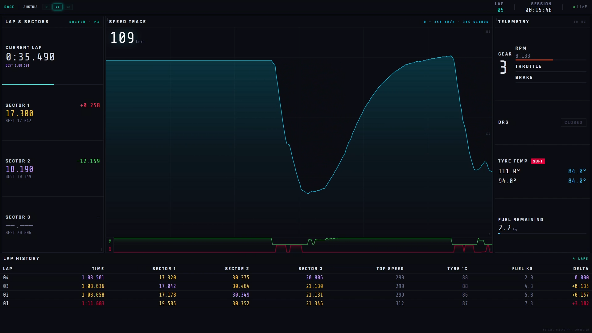

# Portfolio Hub

Welcome to my portfolio. This repository highlights AI-orchestrated systems engineering solutions alongside end-to-end data analytics and business intelligence projects.

---

## Systems Engineering & AI-Orchestrated

### [AI-Orchestrated F1 Telemetry Dashboard](./F1-Pit-Wall-Dashboard)

* **Architecture:** Ingests live binary UDP telemetry (`20777`) from the F1 engine, normalizes nested C-type structs in Python, and streams updates via Server-Sent Events (SSE) at 10 Hz.
* **Orchestration:** Directed LLMs as systems architect to resolve cross-category compound ID mismatches and diagnose custom in-memory tyre object mappings.
* **Telemetry UI:** Native HTML5 canvas rendering speed/input traces, 4-corner thermal matrices, and delta sector timing.

---

## Business Intelligence & Analytics

### [ISP Customer Churn Analysis](./Analytics%20Portfolio/isp-churn)
* Analyzed telecom churn drivers across customer records, identifying that high support contact frequency indicates unresolved technical friction rather than active engagement.

### [Mobile Game A/B Test Analysis](./Analytics%20Portfolio/gaming-ab-test)
* Evaluated promotional monetization variants, demonstrating a 5.3% uplift in average revenue per user (ARPU) with statistical variance validation.

### [Customer Segmentation & Retention](./Analytics%20Portfolio/customer-segmentation)
* Segmented multi-tier retail customer cohorts to design targeted re-engagement strategies aimed at recovering high-risk revenue streams.

---

## Core Tooling & Competencies

* **Systems & Data Streaming:** Python, Flask, UDP Socket Programming, Server-Sent Events (SSE)
* **Frontend Visualization:** HTML5 Canvas, Modern CSS Grid, JavaScript (ES6+)
* **Analytics & BI:** Power BI, Exploratory Data Analysis, Cohort Segmentation, A/B Test Evaluation
* **Workflow:** AI Systems Orchestration, Architecture Mapping, Iterative Debugging
